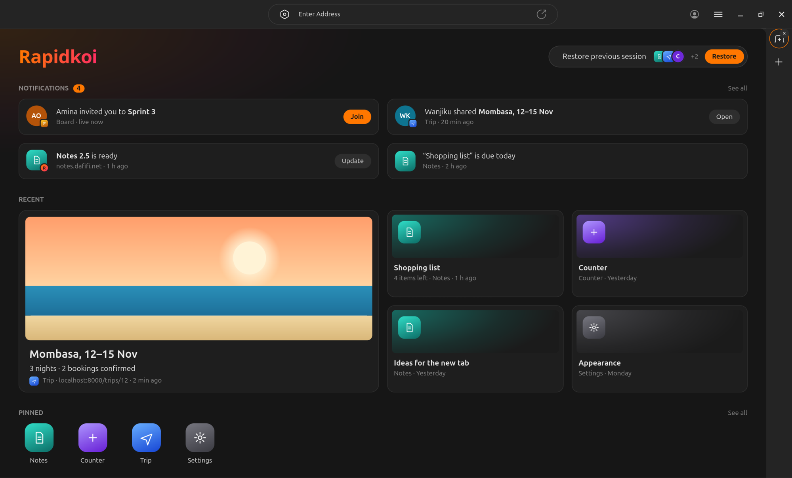

<h1 align="center">Rapidkoi</h1>

<p align="center"><b>You're in control.</b></p>

<p align="center">A browser for apps.</p>

<p align="center">
  
</p>

## Why

On the web, apps decide what they take. In Rapidkoi, you decide what they get.

- Why does a site know your screen, your fonts and your time zone before you've
  clicked anything?
- Why do your notes live on someone else's server, and stop working when the
  internet does?
- Why does every app want an account, a password and your email?
- Why does each app decide whether you can make its text bigger?

None of this has to be true. It happens because every app draws its own screen,
keeps its own data and runs its own sign-in. Rapidkoi takes those jobs back.

## How control works

An app in Rapidkoi doesn't draw. It describes what's on screen, and Rapidkoi
draws it. It doesn't hold its own data, reach the network, or know who you
are. It asks Rapidkoi, and you decide.

**The screen.** Rapidkoi draws every app, so your text size, light or dark,
and contrast apply everywhere, and every app works with a keyboard. Apps never
see your screen, your fonts or your settings, so they have nothing to
fingerprint you with.

**Your data.** Each app keeps its data in its own database on your device. It
works offline, and when you forget an app, its data goes with it.

**Who you are.** There are no passwords. Each app gets its own key for you, so
two apps can't tell they share a person. An app can show your name without
ever learning it: Rapidkoi fills it in on screen.

**The network.** An app can reach only the servers it declared when it was
published, and you can switch each one off.

**The code.** Apps are WebAssembly, signed by their publisher. A page on the
web arrives with the network, cookies and storage built in. A Rapidkoi app
arrives with nothing, and nothing runs until its signature checks out.

## For developers

Most of an app isn't the app. It's the database, the accounts, the
passwords, the servers, the dark mode, the screen reader support. In
Rapidkoi those come with the browser, and you write the part that's yours.

You can still talk to your own server when you need one.

An app is its state, what happens to it, and what it looks like:

```rust
#[derive(Default, State)]
struct Counter {
    count: i64,
}

#[derive(Debug, Clone, PartialEq, Message)]
enum Msg {
    Add,
}

impl App for Counter {
    type Msg = Msg;

    fn handle(self, event: Event<Msg>) -> Next<Self> {
        match event {
            Event::Message { msg: Msg::Add, .. } => {
                Next::state(Counter { count: self.count + 1 }).link(Counter::count)
            }
            _ => Next::state(self),
        }
    }

    fn view(&self) -> View<Msg> {
        column([
            text(&format!("Count: {}", self.count)),
            button("Add").primary().on_press(Msg::Add),
        ])
    }
}
```

`.link(Counter::count)` puts the count in the window's address. Share it, and
the other person opens the counter at that count.

Apps are written in Rust with
[rapidkoi-rust](https://github.com/kithinjibrian/rapidkoi-rust). Publishing
needs no approval: your domain is your identity.

```bash
./main keygen     # once: your publishing key
./main publish    # signs your app into a static site
./main serve site/
```

Put the site on any static host, and the app is at your domain.

## Try it

```bash
./main https://notes.dafifi.net
```

Notes keeps everything on your device, works offline, and gives every note its
own link.

## Roadmap

> [!IMPORTANT]
> Rapidkoi is early. It runs on Linux, and apps are written in Rust.

**Done**

- [x] Apps open by address, signed by their publisher and checked before they run
- [x] Apps kept on your device, so they open at once and run offline
- [x] Links to any screen, with its state
- [x] A database for every app, and large files beside it
- [x] Sign-in without passwords, with a key per app
- [x] Permissions you set per app, and only the servers an app declared
- [x] Your name and times shown in apps, never sent to them
- [x] Opening and saving your files, through Rapidkoi's own dialog
- [x] Your text size, theme and contrast in every app
- [x] Several windows of one app, and your last session restored

**Next**

- [ ] Sync between your devices, through a server that can't read your data
- [ ] Live sessions: everyone with a link in the same app, together
- [ ] History: see any screen as it was, and share it
- [ ] Your contacts, events and files, shared between apps when you choose
- [ ] Notifications, and the new tab in the screenshot
- [ ] Clipboard, drawing, and more of what apps need

**Later**

- [ ] A page for people opening a link without Rapidkoi
- [ ] Apps in TypeScript and other languages
- [ ] macOS, Windows and Android
- [ ] An installer

## Building Rapidkoi

Rapidkoi is written in [Lugha](https://github.com/kithinjibrian/lugha) with
[kivuli](https://github.com/kithinjibrian/kivuli), on GTK 4.

You'll need `lughac`, `libgtk-4-dev`, `libsqlite3-dev`, `libgc-dev`, `pkgconf`
and a C compiler.

```bash
lughac build -O 2 src/main.la -o main
lughac test test/
./main
```
